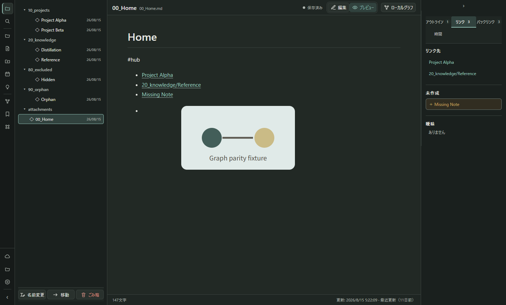
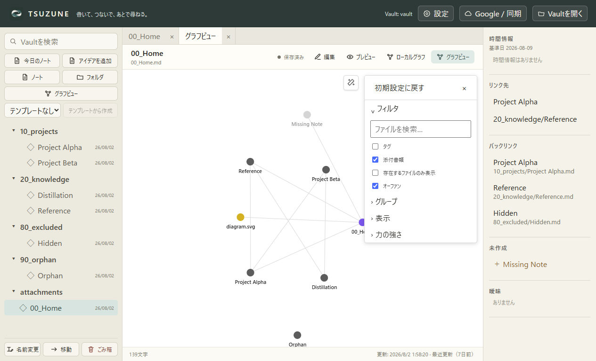

# TSUZUNE

**書いて、つないで、あとで尋ねる。**

TSUZUNEは、普通のMarkdownファイルを原本にするWindows向けの個人用知識ワークスペースです。人はMarkdown記法を覚えなくてもメモを残せ、CodexやChatGPTは出典とrevision境界を保ちながら必要な知識を読み書きできます。

| ノートを自然に書く | 知識をGraphでたどる |
|---|---|
|  |  |

## TSUZUNEでできること

- **自然に書く** — 通常ノートをすぐ編集画面で開き、Daily／Ideaを含む自由に増やせるテンプレートと簡易書式ツールバーを使えます。
- **Markdownを手早く編集する** — `[[` からノート・見出し・ブロックを補完できます。ノートの版履歴を確認し、選択範囲を別ノートへ抽出したり、ノートを統合したりできます。表・脚注の編集や、添付ファイル改名時のリンク更新にも対応します。
- **タスクに戻る** — ルートのToDoとノート本文のタスクを扱えます。「ノートのタスク」で複数ノートのタスクを集約し、元の行に移動したり完了状態を切り替えたりできます。
- **画面を整理する** — 分割・ペイン移動は右上の「…」から操作。ワークスペースはペインごとにノートのカーソル位置・選択範囲・折りたたみを記憶します。左の一覧はノート名を最大2行で表示し、空画面から検索・新規作成できます。画像のあるノートもPreviewで末尾までスクロールできます。
- **画像を貼り付ける** — 画像をコピーし、ノートの編集／Live Preview本文で`Ctrl+V`。画像を同じフォルダへPNGで保存し、画像リンクを挿入します。PNG／JPEGの画像データ、1画像20MBまで。通常のテキスト貼り付けも使えます。
- **分類せず受け取る** — `Ctrl+P`の「受信箱へメモを作成」で、選択中の場所に関係なく`01_受信箱`へ空のメモを作り、そのまま書き始められます。
- **Webを分類せず受け取る** — Chrome／EdgeのBrowser Clipperから、表示中のWebページやYouTubeを出典情報付きMarkdownで`01_受信箱`へ保存できます。通常Webは記事本文を抽出し、YouTubeは画面上の文字起こしから検証済み字幕トラック、取得不能または途中の場合のローカル`yt-dlp`まで順に探して取得状態も残します。初回だけTSUZUNEの通知領域で6桁コードを使ってペアリングします。[Browser Clipper](docs/browser-clipper.md)
- **PDFを読んで引用する** — Vault内のPDFを開いて本文検索やページ移動ができます。ページや選択文への引用リンクをコピーし、ノートから元のPDFに戻れます。
- **数式・図・補足を表示する** — ノートのプレビューで、数式（`$…$`／`$$…$$`）、Mermaidのコードブロック、コールアウト（`> [!note]` など）を表示します。
- **ノートをPDFで保存する** — ノート上部の「PDF書き出し」から、開いた時点の本文をA4／Letter、縦／横で保存できます。未保存の編集も出力に含まれます。数式とMermaidの図を描画し、折りたたんだコールアウトは展開します。
- **ローカルの音声・動画を再生する** — 添付タブ、Canvas、ノートのプレビューで、Vault内の添付をその場で再生できます。ノートには `![[録音.wav]]` のように埋め込めます。再生できる形式はWindows版に同梱されたElectronのコーデックに依存します。
- **Markdownのまま残す** — ノートは`.md`、添付は通常ファイル。TSUZUNEがなくても一般的なeditorで読めます。
- **知識をつなぐ** — `[[Wiki link]]`、backlink、未解決link、ブックマーク、Local/Global Graph。
- **すばやく開く** — `Ctrl+O`のQuick Switcherはタイトル・パス・別名からノートを探せます。`Ctrl+P`でCommand Paletteを開き、タブで複数ノートを行き来できます。参照中のノートを固定すると、別ノートを開いてもタブが残ります。
- **必要なノートを探す** — `Ctrl+Shift+F`で「内容を検索」を開き、AND、除外、`tag:`／`path:`／`file:`／`category:`／`topic:`、完全phraseで絞り込めます。既定では知識・情報源・受信箱・その他に分け、各グループ内は関連度順です。名前や更新日でも並べ替えられます。「一致箇所を表示」から前後の行を確認でき、「この一致へ移動」で該当箇所を編集できます。
- **開く前に内容を見る** — ファイル一覧・検索結果・関連ノートにポインターを重ねると、ノートの内容を確認できます。ソースエディタやLive Previewのノートリンクは、`Ctrl`（macOSでは`⌘`）を押しながらポインターを重ねます。
- **安全に整理する** — 一覧の右クリックから名前変更、移動、`.trash`への退避。衝突時は上書きしません。
- **Canvasで考えを広げる** — 左側の「Canvasを開く」から`.canvas`を作成または開きます。テキストカードやVault内のファイルを配置してつなぎ、グループ化や整列ができます。全体または表示範囲をPNGに出力し、ノートには`![[Board.canvas]]`で読み取り専用のCanvasを埋め込めます。
- **Basesでノートを見渡す** — 左側の「Baseを開く」から`.base`を作成または開きます。ノートのプロパティを表・カード・リスト・Kanbanで表示し、Base内検索やCSV／TSV書き出しができます。Kanbanの列順はドラッグで変更し、設定でプレビューして保存できます。`file.folder`でグループ化したKanbanでは、移動先とリンクへの影響を確認してノートを別フォルダーへ移動できます。
- **他のアプリから移行する** — 「他アプリから取り込む」でMarkdownフォルダー、ChatGPT Export、Notion Export、Evernote ENEXを選択。プレビューを確認してから、現在のVault内の新しいフォルダーへ保存します。
- **画面を広く使う** — 左右のsidebarを独立して閉じ、必要な側だけ再表示できます。
- **古さに気づく** — 最終更新日時と任意の`review_after`から、再確認の目安を非破壊で表示。
- **時間を区別する** — 現在・過去・未来、情報が有効だった時点とAIが知った時点を分離。
- **AIと共有する** — MCP経由で検索、取得、Context構築、revision競合を防ぐ履歴なし更新。
- **任意で同期する** — Google接続と専用Drive folderへの手動preview/apply。Vaultごとに自動同期を有効化すると、初回手動同期後は保存後・定期確認で同期し、競合時は停止します。初期オフ、削除の自動伝播なし。ローカル利用だけでも動作します。
- **Windowsで使い続ける** — user単位installer、アプリ内更新、packaged/installed smokeを含む本番更新gate。

## 現在地

公開版は[変更点と配布ファイル](https://github.com/imonoonoko/TSUZUNE/releases/latest)で確認できます。

| 対象 | 状態 |
|---|---|
| インストール済み本番 | [Project Status](PROJECT_STATUS.md)と最新production receiptを参照 |
| 現在の開発slice | [Product Plan](PLAN.md#current-decision)のCurrent Decisionを参照 |
| Repository | [Public repository](https://github.com/imonoonoko/TSUZUNE) |

本番commit、検証済み範囲、未証明境界は[PROJECT_STATUS.md](PROJECT_STATUS.md)を正本とします。現在のPrimary／Nextと実行順は[PLAN.mdのCurrent Decision](PLAN.md#current-decision)、資料とEvidenceは[docs/INDEX.md](docs/INDEX.md)から辿れます。

## 使い始める

現在のrepository／package versionは`0.7.0`です。[v0.7.0の配布ページ](https://github.com/imonoonoko/TSUZUNE/releases/tag/v0.7.0)またはGitHubの[最新リリース](https://github.com/imonoonoko/TSUZUNE/releases/latest)から、Windows x64用の `TSUZUNE-Setup-<version>.exe` を取得できます。[v0.7.0の変更点](docs/releases/v0.7.0.md)も参照できます。既に使用している場合は、アプリ内で更新を確認できます。

インストール済みbinaryを使う場合:

1. GitHubから取得したインストーラーを起動します。
2. Start menuまたはdesktopの「TSUZUNE」を開きます。
3. 「Vaultを開く」から、Markdownを保存するfolderを選びます。
4. 「ノート」で空のノートを開くか、選択欄からテンプレートを選んで書き始めます。

公開インストーラーはコード署名なしで配布しています。Windowsに発行元不明と表示される場合は、GitHubの公式リリースから取得したファイルであることを確認してください。通常のインストール先は `%LOCALAPPDATA%\Programs\tsuzune` です。アンインストールしてもVaultは削除されません。

## 毎日の書き方

### Markdownを知らない場合

- 「受信箱へメモを作成」は、分類・タイトル・タグを先に決めず、同名衝突を避けた空のメモを`01_受信箱`へ作って編集画面で開きます。
- 「ノート」は同名衝突を避けた空のノートを作り、モーダルを挟まず通常の編集画面で開きます。
- 「今日のノート」はテンプレートから選び、日付入りのDailyを同日一件だけ作ります。
- 「アイデアメモ」はテンプレートから選び、見出し入りのノートを通常編集画面で開きます。
- 見出し、太字、list、checkは書式ボタンから挿入でき、関連ノートはVault一覧から選べます。
- 「テンプレートを追加」で編集可能な雛形を作れます。`90_テンプレート`内のMarkdownは自動的に選択肢へ加わります。

裏側では通常のMarkdownへ保存するため、検索、Wiki link、Graph、MCPとの互換性を失いません。TSUZUNEが生成した既存の定型Daily／Ideaが完全一致する場合だけ、再編集用フォームも利用できます。手書きの見出しや追記がある場合はMarkdownソースを維持して内容を落としません。詳しくは[Templates and Freshness](docs/templates-and-freshness.md)を参照してください。

### Wiki linkを使う場合

```markdown
# プロジェクト概要

関連:
- [[開発方針]]
- [[10_プロジェクト/TSUZUNE|TSUZUNE]]
```

link先、backlink、未作成・曖昧・無効linkを右panelで確認できます。Local Graphは現在ノートの直接linkだけ、Global Graphは孤立ノートを含むVault全体を表示します。

### 検索演算子を使う場合

デスクトップの「内容を検索」とQuick Switcherでは、次の演算子を利用できます。

| 入力例 | 意味 |
|---|---|
| `Project active` | 両方を含むノート（AND） |
| `Project -paused` | `Project`を含み、`paused`を含まないノート |
| `tag:project` | `#project`またはその子tagを持つノート |
| `path:10_projects` | Vault相対pathで絞り込み |
| `file:alpha` | ファイル名で絞り込み |
| `category:知識管理` | frontmatterの主カテゴリ完全一致で絞り込み |
| `topic:"原典,追跡"` | frontmatterのtopic完全一致で絞り込み |
| `"Project Alpha"` | 連続したphraseの完全一致 |
| `(cat OR dog) -(paused OR draft)` | いずれかを含むノートを探し、除外条件をまとめる |
| `content:needle` | 本文を検索する |
| `line:(cat dog)` | 同じ行に両方があるノートを探す。段落や見出しのまとまりを指定する場合は `block:` や `section:` |
| `task-todo:確認` | 未完了タスクを探す。完了済みは `task-done:`、両方を対象にする場合は `task:` |
| `match-case:API` | 大文字小文字を区別する。区別しない範囲は `ignore-case:` |
| `content:/c.t/` | 本文をJavaScriptの正規表現で検索する |
| `[担当:田中] [優先度:>=3]` | frontmatterのプロパティの値で絞り込む |

通常語は大文字小文字を区別せず、空白で区切った条件はANDになります。一つの空白なし日本語自然文は文中の区切り候補をORとして順位付けします。MCP検索でも `category:` と `topic:` が使えます。

## Codex Desktopと連携する

TSUZUNEで使うVaultを一度開いた後、開発repositoryで次を実行します。

```powershell
npm run mcp:register
```

Codex Desktopへ登録するMCP toolは25個です。

| Tool | 用途 |
|---|---|
| `runtime_info` | MCPのversion・起動時刻・更新状態・匿名化Vault IDを確認 |
| `delivery_info` | runtime freshnessとは分離して、sourceとlatest receiptのstatus（match／mismatch／unknown）のみを確認。更新推奨・path・hashは返さない |
| `search` | title、path、本文、category、topicを検索 |
| `fetch` | Markdown noteとrevisionを取得 |
| `list_note_sections` | 保存済み見出し・一意の節ID・revision・原文位置を一覧取得 |
| `fetch_note_section` | revision一致で指定節の原文を追加取得 |
| `get_backlinks` | backlinkを取得（legacy `50_履歴`は除外、path cursorで継続可能） |
| `build_context` | 起点と関連noteを文字数上限付きで構築し、query付きの長い通常起点は関連見出し節を投影して、各sourceのrevision／更新時刻を返す |
| `build_context_set` | 1〜8起点を重複なしで比較し、起点別の状態由来・revision・節省略を返す |
| `list_bases` | 可視な保存済みBaseを名前／パスで探し、ビューと解析診断を返す |
| `query_base` | 保存済み表ビューを画面と同じ評価処理で絞り、型付きセル・グループ・集計を返す |
| `get_local_graph` | 明示リンクを深さ1〜3で探索し、距離・revision・上限による省略を返す |
| `list_directory` | 本文を含めずfolder・note・添付metadataを最大200件取得し、複数ページの同時変更をfingerprintで検出 |
| `preview_drive_sync` | 起動中のTSUZUNE本体でDrive同期内容を確認 |
| `create_directory` | 既存folderへ新規folderを作成 |
| `create_note` | 既存folderへ新規noteを作成 |
| `create_derived_note` | 受信箱原典を概念単位へ分け、カテゴリ付き派生知識を直接作成 |
| `propose_derived_note` | `01_受信箱`／`40_情報源`を変えず、カテゴリ付き派生知識をAI Reviewへ提案 |
| `update_note` | revision一致時だけ更新 |
| `autonomous_update_note` | 通常noteを更新（同一本文はno-op、revision一致時だけ変更） |
| `patch_note` | revision一致時だけ狭い範囲を更新 |
| `preflight_move_entry` | 起動中アプリで単一Markdown移動を事前確認 |
| `move_entry` | fingerprint一致時だけ単一Markdownを移動 |
| `trash_entry` | 明示依頼時だけ、リンク元のない受信箱原典をrevision一致で復元可能な`.trash`へ移動 |
| `apply_drive_sync` | 確認済みDrive同期planを再検査して適用 |

AI更新は履歴を生成せず、revision一致時だけ通常ノートを更新します。指定した`expected_revision`が古い場合は先に拒否し、本文が完全に同一なら`unchanged: true`を返します。既存の`50_履歴`はlegacyデータとして読み書き対象から除外・保護します。原典の`40_情報源`もMCPの作成・通常更新・自動更新を拒否します。設定の「AIレビュー対象パス」では、これらのツールを即時適用せずVault外の提案へ切り替え、Settingsから承認・取消できます。

受信箱整理では、AIが原典を非信頼データとして最後まで読み、0〜複数の再利用可能な概念へ分けます。各概念は安定した`derivation_key`、`30_知識/TSUZUNE分類と保存基準.md`の現行主カテゴリ1件、topic 1〜3件を持ちます。同じ原典revisionでも異なる概念keyなら複数ノートを作れ、同じkeyだけを重複として拒否します。既存知識の本文は自動置換せず、関連知識へのWikiリンクを派生ノート側に置きます。同一概念に新しい知識がなければノートを増やさず、受信箱地図の処理済みrevisionだけを更新します。権限衝突、採否不明、機微・危険情報は地図で保留します。通常は原典を保ち、利用者が明示した場合だけ、出典URL・revisionを派生知識へ残してリンク元を解消した後に`trash_entry`で復元可能な`.trash`へ移します。`40_情報源`、`knowledge.md`、`50_履歴`は対象外です。

通常のCodex登録面には、永久削除、強制上書き、Google認証を含めません。`trash_entry`は利用者の明示依頼、`01_受信箱`、revision一致、Wiki-link参照ゼロを要求し、MCPから直接、復元可能なVault内`.trash`へ移します。`create_directory`は既存親フォルダの直下だけを確認付きで作成します。一般ノートの移動は、起動中アプリへ`preflight_move_entry`で事前確認し、そのfingerprintを確認付き`move_entry`へ渡した場合だけ実行します。一般moveのアプリ不在時fallbackや旧`move_note`はありません。Drive同期も起動中アプリのloopback bridgeを通し、Google tokenはMCPへ渡しません。direct server専用の`suggest_links`と`add_link`は通常のCodex登録面には公開しません。

登録解除:

```powershell
npm run mcp:unregister
```

詳細は[MCP Integration Guide](docs/mcp-integration.md)を参照してください。

## Google接続は任意

Googleへ接続しなくても、local Vault、Graph、MCPを使えます。標準接続は基本profileと`drive.file`に限定し、TSUZUNE専用Drive folderを手動でpreview/applyします。Calendar読取を有効にした場合だけ、`calendar.events.readonly`を追加で要求します。

v0.7.0の配布候補はGoogle OAuthのクライアント情報を同梱していません。Google接続を使う場合は、設定で自分のDesktop OAuthクライアントの設定ファイルを読み込んでください。Vaultごとの自動同期は既定でオフです。

- Google広告profile、検索履歴、他appのDrive全体は取得しません。
- token、OAuth JSON、account情報をVaultやGitへ保存しません。
- 既定では片側削除を伝播せず、残存側をpreserveします。
- 隔離2 profileでのDrive roundtrip（別Vault受信、更新、競合、再起動、削除非伝播）は2026-08-16に受入済みです。[受入証拠](docs/reports/drive-vault-roundtrip-acceptance-2026-08-16.md)
- Settingsで削除伝播を明示有効化した場合だけ、確認付き手動applyでlocal削除をDrive trash、remote削除をlocal `.trash`へ移します。tombstone、stale-plan、再起動収束は隔離実Driveで受入済みです。[受入証拠](docs/reports/drive-deletion-propagation-acceptance-2026-08-17.md)

OAuth build、credential保存、update/releaseの運用は[Windows Production Guide](docs/windows-production.md)を参照してください。

## データ保護

- 保存前に更新時刻を照合し、外部変更との競合を通知します。
- 保存は同じfolder内の一時fileを経由します。
- renameとmoveは既存項目を上書きしません。添付の改名では、参照先が一意に解決できるMarkdownリンク・埋め込みを更新します。
- ノートの[版履歴](docs/note-history.md)と[抽出・統合](docs/note-composer.md)はVault内のローカルファイルとして扱います。
- deleteはVault内`.trash`へ退避します。
- dot folderとsymbolic linkはVault一覧から除外します。
- cache、index、GraphはMarkdownと添付から再構築可能に保ちます。

## 開発する

必要環境:

- Windows
- Node.js 22
- npm 11

```powershell
npm ci
npm run dev
```

主な検証:

```powershell
npm run typecheck
$env:NODE_OPTIONS='--max-old-space-size=6144'
npx vitest run --maxWorkers=1
npm run check:mcp
npm run build
```

installerの作成と確認:

```powershell
npm run pack:win
npm run check:installer
npm run check:packaged
```

`npm run production:update`は、対象PCの既存installationとproduction profileを検査・更新するmaintainer向けコマンドです。通常の開発や文書変更では実行しません。

## Documentation

- [Project Status](PROJECT_STATUS.md) — 現在の本番、最新検証、次の一手
- [Product Plan](PLAN.md) — 実行順、受入条件、保留Track、長期roadmap
- [Product Definition](PRODUCT.md) — 製品原則と非目標
- [Design System](DESIGN.md) — GUI、brand、accessibility
- [Documentation Index](docs/INDEX.md) — 機能別guideとEvidence
- [Obsidian Graph Parity Reference](docs/obsidian-graph-parity-reference.md) — 固定比較契約と未証明境界
- [Windows Production Guide](docs/windows-production.md) — installer、update、release
- [Security Policy](SECURITY.md) — 脆弱性を公開Issueにせず報告する方法

## License

Copyright (c) Im_onoko. All rights reserved.

このrepositoryは公開されていますが、現時点でオープンソースライセンスは付与されていません。
